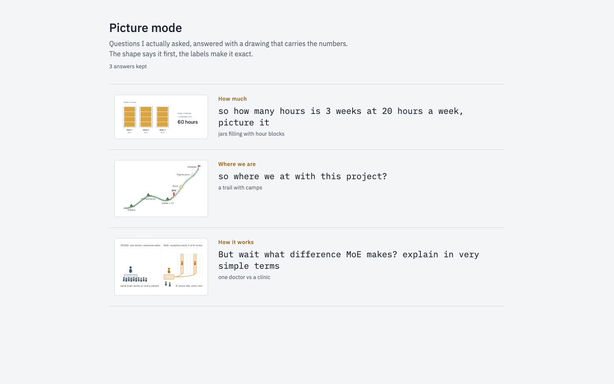
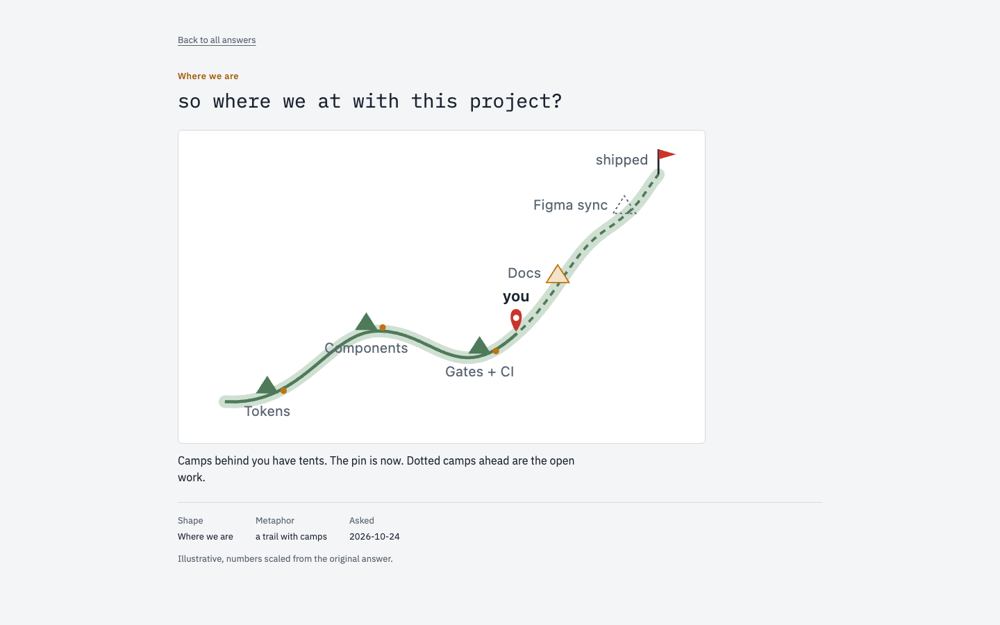

# picture-answers



A Claude Code skill that answers some questions with a drawing first: a metaphor that carries its numbers, with the text under it. Plus a small static gallery for the answers worth keeping.

Two piles instead of two bars. A clinic with two lit rooms instead of a router diagram. A trail with tents behind you instead of a checklist.

## When it draws

- How much: piles, jars, slices of one loaf, one unit per coin or block.
- How it works: rooms and doors, where every moving part maps to a real one.
- Which is better: a scale or two shelves, with the verdict visible before any label.
- Where things stand: a trail with camps, done, in progress and open marked differently.

If the numbers can't be drawn to scale in the metaphor, it falls back to a plain box diagram.

## What's here

- `skill/picture/`: the skill. `SKILL.md` is the contract, `scripts/capture.py` saves each picture with its question before it is shown, `scripts/keep.py` copies one into a gallery repo on its own branch, `examples/` holds three drawings.
- `gallery/`: a dependency-free Node build that turns `entries/` into a static site, one page per kept answer.

## Try it

Copy the skill into your Claude Code skills folder:

```bash
cp -r skill/picture ~/.claude/skills/picture
```

`keep` needs a gallery repo. Point it at one in `~/.claude/picture-mode/config.json`:

```json
{"gallery": "/path/to/your/gallery/repo"}
```

Build the gallery:

```bash
cd gallery && npm run build
```

The build writes `gallery/dist/`, a static site with an index and one page per kept answer. Serve it with any static server, for example `cd gallery/dist && python3 -m http.server 5322`.



Each entry page shows the question as it was typed, the picture, a one-line reason for the metaphor, and the shape, metaphor and date. The three entries in `gallery/entries/` are jars of hour blocks, a trail with camps and a doctor-versus-clinic picture for mixture of experts.

## Tests

```bash
python3 -m unittest discover -s skill/picture/scripts -p "test_*.py"
cd gallery && npm test
```

Status: exploration. No license chosen yet.
